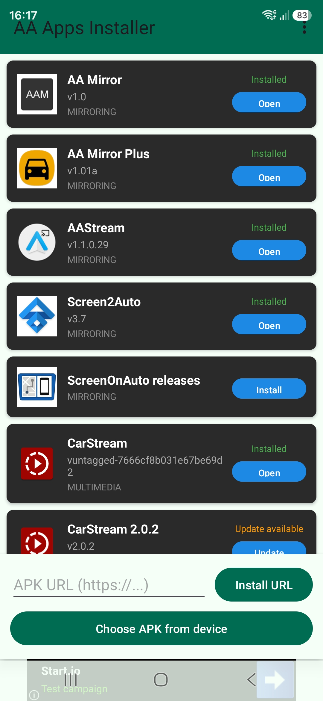
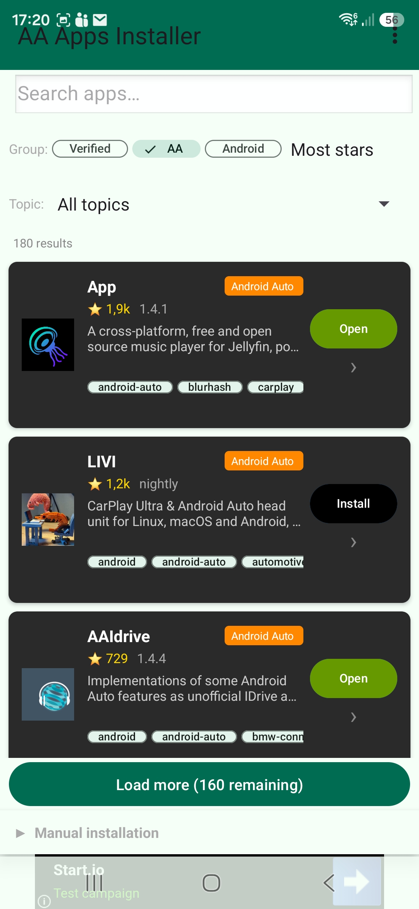
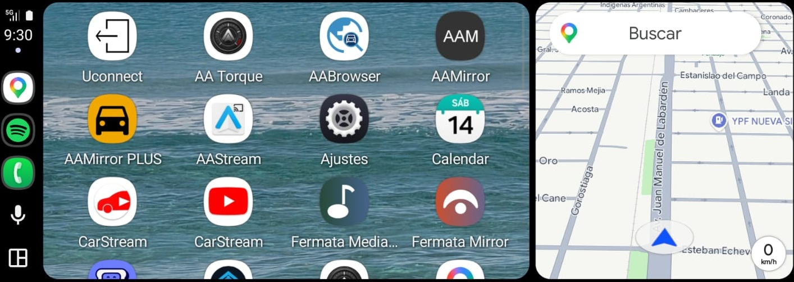

# AAAI – Android Auto Apps Installer

AAAI is a simple Android app that lets you browse, download and install community-made apps for **Android Auto**.

Project page: <https://github.com/pablosguajardo/AAAI>

> **Disclaimer:** This project is provided for **testing and evaluation purposes only**. It is offered "as is", without warranty of any kind. The author assumes no responsibility or liability for any damage, data loss, malfunction or other consequences resulting from the use of this app or of any app installed through it. Use it at your own risk.

## What does it do?

- Shows a catalog of Android Auto apps, grouped by category (multimedia, screen mirroring, utilities).
- Downloads and installs the apps for you, so you don't have to hunt for APK files.
- **Installs any APK you want**, unlike similar installers: paste a direct download **URL**, or pick an **APK file already stored on your phone**.
- Tells you which apps are already installed and which ones have an update available.
- For apps published on GitHub, lets you pick which release to install.
- Includes a short first-run guide that helps you prepare your phone (permissions and Play Protect).
- Has an **About** screen with the project link, a disclaimer and the list of GitHub repositories the apps come from.

## How it works

The list of apps is a simple catalog bundled with the app. Each entry points either to a direct download or to a GitHub repository, in which case the app looks at the repository's releases to find the APK. New GitHub-based apps added to the catalog automatically show up in the About screen.

## Getting started

1. Download the latest APK from the project's releases page.
2. Install it and follow the setup guide on first launch.
3. Pick an app from the list and tap **Install**, or use the URL field / file picker to install your own APK.

## Advertising

AAAI shows a small banner ad at the bottom of the main screen and, once in a while (every few installs), a full-screen ad so that development can continue. Ads are provided by [Start.io](https://www.start.io). Thank you for your support!

## Credits

The apps listed in AAAI belong to their respective developers. Many of them are downloaded straight from these GitHub repositories:

- [CarStream](https://github.com/thekirankumar/carstream-android-auto) – thekirankumar/carstream-android-auto
- [Fermata Auto](https://github.com/AndreyPavlenko/Fermata) – AndreyPavlenko/Fermata
- [ScreenOnAuto](https://github.com/slzn/ScreenOnAuto-releases) – slzn/ScreenOnAuto-releases
- [Performance Monitor](https://github.com/jilleb/mqb-pm) – jilleb/mqb-pm
- [AATorque](https://github.com/agronick/aa-torque) – agronick/aa-torque
- [AA Passenger](https://github.com/martoreto/aapassenger) – martoreto/aapassenger
- [AA Browser](https://github.com/kododake/AABrowser) – kododake/AABrowser
- [AAAnything](https://github.com/kododake/AAAnything) – kododake/AAAnything
- [Widgets For Android Auto](https://github.com/ns130291/widgets-for-auto) – ns130291/widgets-for-auto
- [Nav2Contacts](https://github.com/frankkienl/Nav2Contacts) – frankkienl/Nav2Contacts
- [HomeCar](https://github.com/RenanEspinar/HomeCar) – RenanEspinar/HomeCar

This project is **not affiliated with, endorsed by, or sponsored by** any of them. Please check each project's repository for its own license and terms.

## License

AAAI is released under the [MIT License](LICENSE.md).
