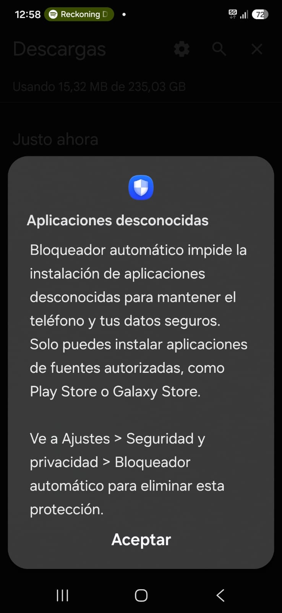
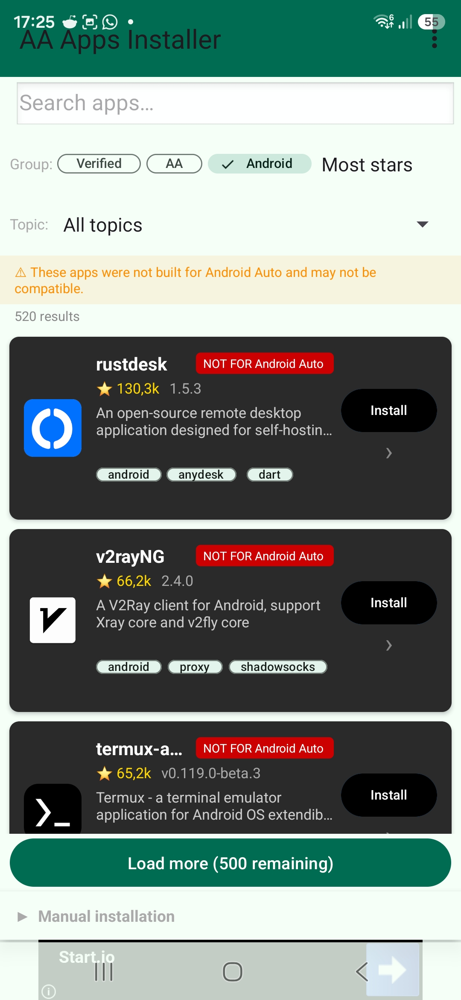
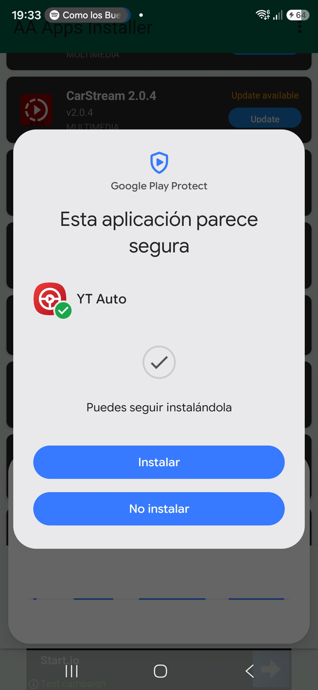
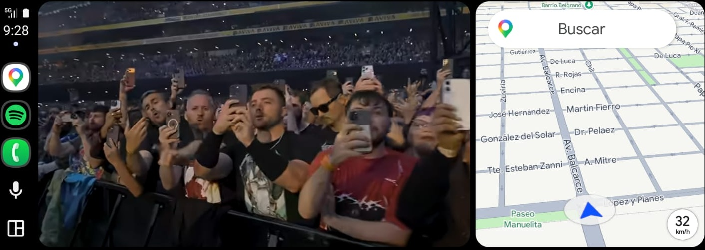
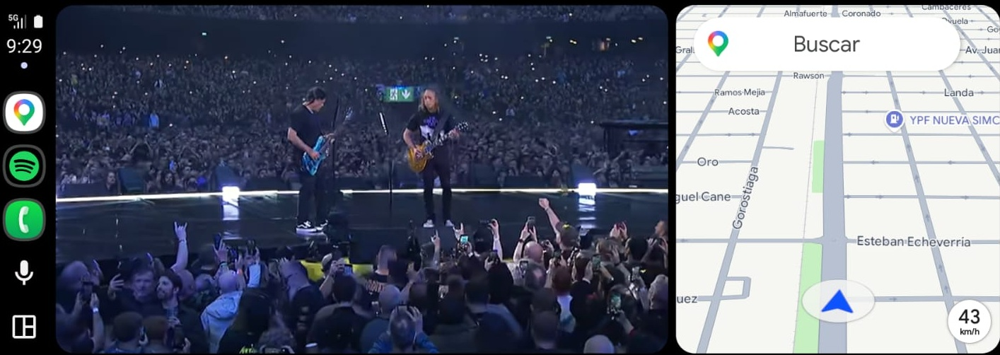
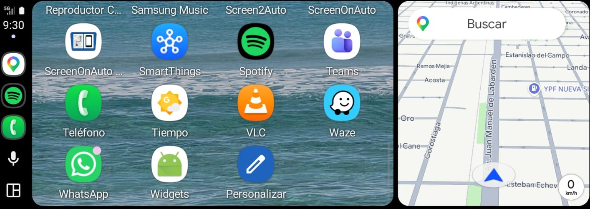
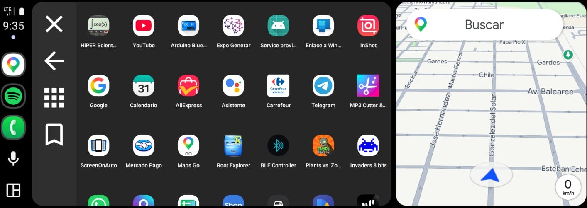
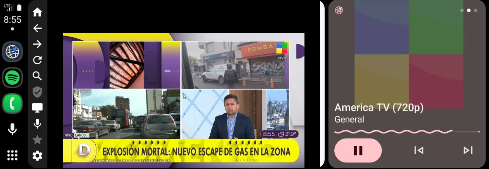
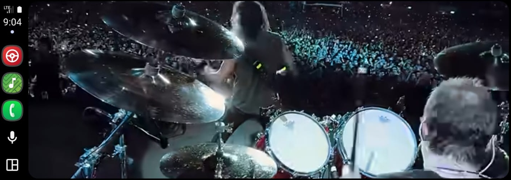

# AAAI – Android Auto Apps Installer

AAAI is a simple Android app that lets you browse, download and install community-made apps for **Android Auto**.

Project page: <https://github.com/pablosguajardo/AAAI>

> **Disclaimer:** This project is provided for **testing and evaluation purposes only**. It is offered "as is", without warranty of any kind. The author assumes no responsibility or liability for any damage, data loss, malfunction or other consequences resulting from the use of this app or of any app installed through it. Use it at your own risk.

## What does it do?

- Shows a catalog of Android Auto apps, grouped by category (multimedia, screen mirroring, utilities).
- Downloads and installs the apps for you, so you don't have to hunt for APK files.
- **Installs any APK you want**, unlike similar installers: paste a direct download **URL**, or pick an **APK file already stored on your phone**.
- Tells you which apps are already installed and which ones have an update available.
- For apps published on GitHub, lets you pick which release to install.
- Includes a short first-run guide that helps you prepare your phone (permissions and Play Protect).
- Has an **About** screen with the project link, a disclaimer and the list of GitHub repositories the apps come from.

## How it works

The list of apps is a simple catalog bundled with the app. Each entry points either to a direct download or to a GitHub repository, in which case the app looks at the repository's releases to find the APK. New GitHub-based apps added to the catalog automatically show up in the About screen.

## Getting started

AAAI is not distributed through the Google Play Store, so Android will ask for a few extra permissions the first time. Follow these steps **before installing**:

### Before installing

1. **Download the APK** from the project's releases page, using your phone's browser. [Download Latest](https://github.com/pablosguajardo/AAAI/releases/latest)
2. **Allow installing apps from unknown sources.** When you open the downloaded APK, Android will show a prompt asking to allow your browser (or file manager) to install apps. Tap **Settings** and enable **Allow from this source**, then go back and continue. The exact wording and menu location vary by manufacturer and Android version (usually *Settings > Apps > Special access > Install unknown apps*).

3. **If Google Play Protect blocks the installation**, you may see a message like "Blocked by Play Protect" or "App not trusted". This happens because the app is not published on the Play Store. To continue:
   - Tap **More details** (or **Details**), then **Install anyway**; or
   - Temporarily turn off scanning: open the **Google Play Store**, tap your profile picture, go to **Play Protect > Settings (gear icon)** and disable **Scan apps with Play Protect**. You can turn it back on after installing.
4. **Install the app** and open it.

### Using AAAI

1. On first launch, follow the setup guide shown by the app.
2. Allow AAAI itself to install apps when it asks (the same "unknown sources" permission, this time for AAAI).
3. Pick an app from the list and tap **Install**, or use the URL field / file picker to install your own APK.
4. Apps installed through AAAI may also trigger Play Protect warnings. Use **Install anyway** if you trust the app.

> Only install apps from sources you trust. Turning off Play Protect lowers your phone's protection, so re-enable it when you are done.

## To do

- **Keep apps updatable after reinstalling AAAI (feasibility study).** Apps installed through AAAI are signed with a key that AAAI generates on first use and stores in its private folder. If AAAI is uninstalled and installed again, that key is lost: the apps are still recognised as installed (their renamed package name is fixed), but Android refuses to update them because the signature differs, so they must be uninstalled first (their data is lost). Two options to evaluate:
  - **Deterministic per-device key.** Derive the signing key from a device identifier (e.g. `ANDROID_ID`) plus a fixed salt, with a fixed certificate (serial number, validity dates and name), so the same key is regenerated after a reinstall. Points to check: `ANDROID_ID` changes with a factory reset and, on Android 8+, depends on the signing key of the app (debug vs release builds give different values); the salt cannot be secret because the project is open source, so the key is weaker than a random one; the key derivation must stay identical across BouncyCastle versions; apps already installed with the current random key would not benefit.
  - **Include the keystore in Android's automatic backup** (as is already done for the install counter), so it can be restored on reinstall. Points to check: restoring is not guaranteed, especially for APKs installed manually, and it depends on the user having backup enabled.

## Advertising

AAAI shows a small banner ad at the bottom of the main screen and, once in a while (every few installs), a full-screen ad so that development can continue. Ads are provided by [Start.io](https://www.start.io). Thank you for your support!

## Credits

The apps listed in AAAI belong to their respective developers. Many of them are downloaded straight from these GitHub repositories:

- [CarStream](https://github.com/thekirankumar/carstream-android-auto) – thekirankumar/carstream-android-auto
- [Fermata Auto](https://github.com/AndreyPavlenko/Fermata) – AndreyPavlenko/Fermata
- [ScreenOnAuto](https://github.com/slzn/ScreenOnAuto-releases) – slzn/ScreenOnAuto-releases
- [Performance Monitor](https://github.com/jilleb/mqb-pm) – jilleb/mqb-pm
- [AATorque](https://github.com/agronick/aa-torque) – agronick/aa-torque
- [AA Passenger](https://github.com/martoreto/aapassenger) – martoreto/aapassenger
- [AA Browser](https://github.com/kododake/AABrowser) – kododake/AABrowser
- [AAAnything](https://github.com/kododake/AAAnything) – kododake/AAAnything
- [Widgets For Android Auto](https://github.com/ns130291/widgets-for-auto) – ns130291/widgets-for-auto
- [Nav2Contacts](https://github.com/frankkienl/Nav2Contacts) – frankkienl/Nav2Contacts
- [HomeCar](https://github.com/RenanEspinar/HomeCar) – RenanEspinar/HomeCar
- [YT Auto](https://github.com/begati/yt-auto) – begati/yt-auto
- [7x Lyrics](https://github.com/c9hama/7x-Lyrics) – c9hama/7x-Lyrics
- [RadioDroid](https://github.com/morckx/RadioDroid) – morckx/RadioDroid
- [YouTube Companion](https://github.com/seinist/youtube-companion) – seinist/youtube-companion
- [AA Browser CarWeb](https://github.com/fcaronte/AABrowser) – fcaronte/AABrowser
- [Fermata-Xtream](https://github.com/malebuffy/Fermata-Xtream) – malebuffy/Fermata-Xtream
- [Meld](https://github.com/FrancescoGrazioso/Meld) – FrancescoGrazioso/Meld
- [SpotiDuck](https://github.com/23fpsz/SpotiDuck-Releases) – 23fpsz/SpotiDuck-Releases
- [Metrolist](https://github.com/MetrolistGroup/Metrolist) – MetrolistGroup/Metrolist
- [Vela Maps](https://github.com/PimpinPumpkin/Vela) – PimpinPumpkin/Vela
- [RF Sentinel](https://github.com/CIS-C0/RFSentinel) – CIS-C0/RFSentinel
- [Nuomi Player](https://github.com/charlottejas/NuomiPlayer) – charlottejas/NuomiPlayer
- [Lumora Player](https://github.com/LumoraPlayer/Lumora) – LumoraPlayer/Lumora
- [AA Mods](https://github.com/ImNoammm/aa-mods) – ImNoammm/aa-mods
- [xFermaTube](https://github.com/juntulis/xFermaTube) – juntulis/xFermaTube
- [Horizon Maps](https://github.com/benbishop028-arch/Horizon-Maps) – benbishop028-arch/Horizon-Maps
- [Bit Chord](https://github.com/kushagrasinghx/BitChord) – kushagrasinghx/BitChord
- [Fermata X](https://github.com/chuoinho/FermataX) – chuoinho/FermataX
- [Dash Glance Clock](https://github.com/FilipNone/DashGlance-Clock) – FilipNone/DashGlance-Clock
- [Calculator](https://github.com/FossifyOrg/Calculator) – FossifyOrg/Calculator

This project is **not affiliated with, endorsed by, or sponsored by** any of them. Please check each project's repository for its own license and terms.

## License

AAAI is released under the [MIT License](LICENSE.md).
